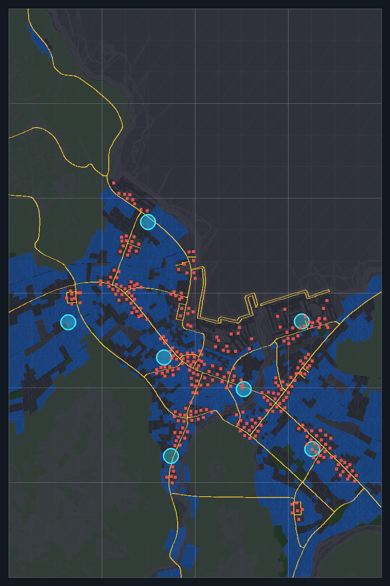
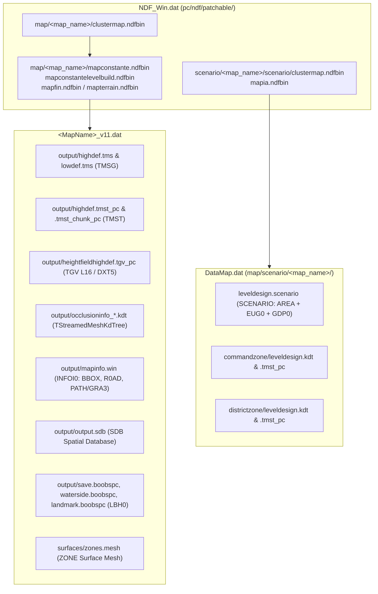

# Wargame: Red Dragon — Complete Map Format Specification & Compiler Blueprint

This document records the byte-level binary specifications, checksum algorithms, and engine loader routines for *Wargame: Red Dragon* (IRISZOOM engine) maps, reverse-engineered directly from [`WarGame3.exe.c`](WarGame3.exe.c) and verified against the unpacked files of `_2x2_port_Wonsan` using [`wrd_map_inspector.py`](wrd_map_inspector.py).

---

## 1. Architecture & Archive Layout

A playable map in *Wargame: Red Dragon* is distributed across three `.dat` (`EDAT`) virtual filesystem archives:

### Coordinate System & Dimensions (`_2x2_port_Wonsan`)
- **Playable High-Def Area:** `1,310,720.0 × 1,966,080.0` Eugen units (`0x49a00000` × `0x49f00000`).
  - Divided into `NbCaseX = 4` by `NbCaseY = 6` (`24` tiles) of `327,680.0 × 327,680.0` (`0x48a00000`) units each in [`highdef.tms`](highdef.tms).
- **Low-Def Backdrop Area:** Divided into `2 × 3 = 6` tiles of `655,360.0 × 655,360.0` (`0x49200000`) units each in [`lowdef.tms`](lowdef.tms).

---

## 2. Container & Integrity Checksum Summary

> [!IMPORTANT]
> Four map formats enforce strict cryptographic or cyclic redundancy checksums on load. Modifying a single byte without recomputing these checksums causes the engine to reject the map or abort. All four have been reverse-engineered and verified:

| File / Format | Loader Function in [`WarGame3.exe.c`](WarGame3.exe.c) | Checksum Offset | Exact Algorithm (Verified) |
| :--- | :--- | :--- | :--- |
| [`output.sdb`](output.sdb) (`SDB\r\n`) | `FUN_008efdc0` (L1054995) Writer: `FUN_008effb0` (L1055065) | `0x05..0x15` (16B) | `MD5(b"SDB\r\n" + file[21:])` |
| [`leveldesign.scenario`](leveldesign.scenario) (`SCENARIO\r\n`) | `FUN_00f319b0` (L2388000) | `0x0A..0x1A` (16B) | `MD5(b"SCENARIO\r\n" + file[28:])` *(skips 2 alignment bytes at `26..28`)* |
| [`*.boobspc`](save.boobspc) (`LBH0`) | `FUN_008f1d70` (L1056950) | `0x08..0x0C` (4B) | `zlib.crc32(file[0x54:]) & 0xFFFFFFFF` |
| [`surfaces/zones.mesh`](zones.mesh) (`ZONE`) | `FUN_00f8fea0` (L2471285) CRC16: `FUN_00503640` (L144603) CRC32: `FUN_00503750` (L144669) | `0x0A..0x0C` (2B) `0x0C..0x10` (4B) `SEC1/2/3 + 4` (4B) | **Header (`0x0A`):** Chained CRC-16-ARC (`poly=0xA001`) across `0..4`, `4..6`, `6..10` with 16-bit bit-reversal between calls. **Payload (`0x0C`):** `zlib.crc32(file[16:])` **Sections (`SEC1/2/3`):** `zlib.crc32(sec_payload)` |

---

## 3. Detailed Binary Format Specifications

### 3.1 `TMSG` — Terrain Visual Mesh (`output/highdef.tms`, `output/lowdef.tms`)
- **Engine Class:** `Eugen::TTerrainGeometryLoader` (`FUN_00f63c60` at L2431800, header check `FUN_00f751c0` at L2447334, cell loader `FUN_00f71fd0` at L2444700).
- **Header (`872` bytes = `0x368`):**
  - `0x00..0x10`: `"TMSG"` (4B), `version = 3` (`uint32`), `"PC\x00\x00"` (4B), `file_size` (`uint32`).
  - `0x10..0x24`: `NbCaseX` (`uint32`), `NbCaseY` (`uint32`), `SubdivPerSide` (`uint32`: `4` for HD, `8` for LD), `CaseSizeX` (`float32`), `CaseSizeY` (`float32`).
  - `0x24..0x3C`: `(Offset, Size)` pairs (`uint32 × 6`) for `Cells` (`NbCaseX * NbCaseY * 48`), `SubCells`, and `GeoBuffer`.
  - `0x3C..0x23C` (512B): Null-padded vertex format path `"$/M3D/System/VertexType/TVertex__PositionIn4w_4w__NormalIn01_4ubn"` (12 bytes/vertex: `uint16[4]` quantized `(x, y, z, w)` + `uint8[4]` normal).
  - `0x23C..0x254` (24B): Map dimensions (`1310720.0`, `1966080.0`, `max_z = 125245.1`, etc.).
  - `0x254..0x264` (16B): `(ExtraBuf1Offset, ExtraBuf1Size, ExtraBuf2Offset, ExtraBuf2Size)`.
  - `0x264..0x368` (260B): Zero padding (note: `uint32` at `0x264` must be `0`, enforced by `param_1[0x95] == 0`).
- **Cell Descriptor (`48` bytes each at `CellsOffset`):**
  - `flags` (`uint32`: `3`), `(vb_offset, vb_size, vertex_count)`, `(ib1_offset, ib1_size, ib1_index_count)`, `(ib2_offset, ib2_size, ib2_index_count)`, `(subcell_offset, subcell_size)`.
- **SubCell Descriptor (`20` bytes each at `SubCellsOffset + subcell_offset`, parsed in `FUN_00f74410` at L2446560):**
  - `uint16 base_vertex, vertex_count, ib1_start, ib1_count, ib2_start, ib2_count`, `float32 min_z, max_z`.
- **Index Buffers (`IB1`, `IB2`, parsed in `FUN_005ba480` at L317916):**
  - Starts with `uint32 uncompressed_byte_size` (`index_count * 2`), followed by a `Z_SYNC_FLUSH` `zlib` stream (`78 da ...`) of `int16` index deltas. The loader runs a cumulative sum (`acc = (acc + delta[i]) & 0xFFFF`) to reconstruct the `uint16` triangle indices.

> [!TIP]
> **Compiler Shortcut for `VBUF` Vertex Buffers (`FUN_005eeaa0` at L368115 & `FUN_00598b70` at L285067):**
> Official `.tms` files compress vertex attributes using a custom bit-packed LZ/delta table (`table_mode = 2`, `compression_mode = 2`). However, the engine's `VBUF` loader explicitly supports **`table_mode = 0`** (at byte `+11` of the 12-byte `VBUF` header) and **`compression_mode = 0` (raw) or `1` (standard `zlib`) with `prediction_mode = 0` (direct strided copy via `FUN_005ccad0` / `FUN_005cca20`)** in each `SUBP` attribute chunk! Our custom map compiler can emit `mode = 0` or `mode = 1` `VBUF` chunks without needing to re-implement Eugen's proprietary LZ encoder.

---

### 3.2 `INFOI0` — Pathfinding & Road Network (`output/mapinfo.win`)
- **Engine Class:** `Eugen::IA::TMapInfo` (`FUN_00aef710` at L1490331).
- **Header (`20` bytes):** `"INFOI0\r\n"` (8B), `version = 1` (`uint32`), `chunk_count = 9` (`uint32`), `payload_size` (`uint32`).
- **Chunk Framing:** `[tag: 4B][index: uint32][size: uint32][payload: size B][end_tag: 4B]`.
  - **`VISI` & `TERR`:** Ignored by `FUN_00aef710` (`default:` switch case skips payload).
  - **`BBOX` (`16` bytes):** `float32 min_x, min_y, max_x, max_y` (`0.0, 0.0, 1310720.0, 1966080.0`).
  - **`R0AD` (`FUN_00abe860` at L1449465):**
    - 20B Header: `uint16 node_count` (`1856`), `uint16 edge_count` (`1860`), `uint32 off_nodes` (`20`), `uint32 off_edges` (`22292`), `uint32 off_edge_meta` (`33452`), `uint32 off_kdtree` (`40892`).
    - **Nodes (`12B` each):** `uint16 edge_count, uint16 first_edge_idx, float32 x, float32 y`.
    - **Edges (`6B` each):** `uint16 target_node_idx, uint16 rev_idx, uint16 dist_weight`.
    - **KD-Tree at `off_kdtree`:** 2D spatial lookup tree over the `1,856` road nodes.
  - **`PATH` (`index = 0..4`, `FUN_00ab1160` at L1438088):**
    - Starts with `"GRA3"` (4B), followed by a 52-byte header: `float32 origin_x, origin_y, max_extent`, `uint16 node_count`, `uint16 fine_node_count`, `uint32 off_nodes` (`52`), `uint32 off_edges`, `uint32 off_polys`, `uint32 off_kdtree`, `uint32 off_extra`, `"GRA3"`, `uint32[3] zeros`.
    - **Nodes (`24B` each):** `float32 x, y, clearance_radius`, `uint32 first_edge_idx, flags, poly_offset`.
    - **KD-Tree (`FUN_00aaf390` at L1436520):** `uint16` tag where `bit 0 == 1` is a 12-byte split node (`uint16 tag_axis, uint16 right_word_offset, float32 split_val, uint32 pad`) and `bit 0 == 0` is a leaf with `count = word >> 1` followed by `count` `uint16` node indices.
    - **Compiler Shortcut:** In `FUN_00aef710`, if `PATH` chunks `0, 1, 2, 4` have `size = 0` and only `PATH[3]` is populated, the engine automatically clones `PATH[3]` for the other movement layers.

---

### 3.3 `TStreamedMeshKdTree` — Raycast & Zone KD-Trees (`*.kdt`)
- **Engine Class:** `Eugen::TStreamedMeshKdTree` (`FUN_00692940` at L514115, `FUN_00699d80` at L520002).
- Stored inside an `EUG0/CNDF` binary NDF container with a single root object of class `TStreamedMeshKdTree`.
- The raw KD-tree nodes, triangle indices, and 12-byte `float32[3]` vertices are packed inside the `Storage` (`blob`) property and indexed by `OffsetOfMainNode`, `OffsetOfTriangleIndexLists`, `OffsetOfIndexBuffer`, `OffsetOfVertexBuffer`, `VertexCount`, and `TriangleCount`.

---

### 3.4 `ZONE` — Environmental Surface Mesh (`surfaces/zones.mesh`)
- **Loader:** `FUN_00f8fea0` (L2471285), `FUN_00f904d0` (`SEC1`, L2471570), `FUN_00f907c0` (`SEC2`, L2471755).
- **Header (`32` bytes):**
  - `0x00..0x04`: `"ZONE"`
  - `0x04..0x06`: `uint16 version` (`2`)
  - `0x06..0x0A`: `uint32 file_size`
  - `0x0A..0x0C`: `uint16 hdr_crc16` (chained CRC-16-ARC across `0..4`, `4..6`, `6..10`)
  - `0x0C..0x10`: `uint32 payload_crc32` (`zlib.crc32(file[16:])`)
  - `0x10..0x20`: `uint32 section_count` (`3`), `uint32 sec1_off, sec2_off, sec3_off`.
- **Sections:**
  - **`SEC1`:** `"SEC1"` (4B), `uint32 crc32`, `uint32 byte_size`, followed by 4-byte-aligned `(uint16 len, uint16 crc16, char[len])` strings.
  - **`SEC2`:** `"SEC2"` (4B), `uint32 crc32`, `uint32 byte_size`, followed by `uint32 vertex_count` (`124,613`), `float32[4] bbox2d`, and `vertex_count × 8B` (`float32 x, y`).
  - **`SEC3`:** `"SEC3"` (4B), `uint32 crc32`, `uint32 byte_size`, `uint32 tri_count` (`103,398`), followed by `tri_count × 16B` (`uint32 v0, v1, v2, surface_type`). Surface types: `18` (`0x12`, water), `42` (`0x2A`, open ground), `70` (`0x46`, forest), `102` (`0x66`, swamp/urban).

---

### 3.5 `LBH0` — Placed 3D Props & Forests (`output/*.boobspc`)
- **Engine Class:** `Eugen::TLevelBuildGeoDatabase` (`FUN_008f1d70` at L1056950, group loader `FUN_008f2480` at L1057320).
- **Header (`84` bytes = `0x54`):**
  - `"LBH0"` (4B), `version = 5` (`uint32`), `crc32` (`uint32` over `file[0x54:]`), `flags = 3` (`uint32`), `max_id` (`uint32`).
  - Seven `(offset, byte_size)` pairs (`14 × uint32`) for: `GridTable0`, `GridTable1` (`24B` cells), `GroupsA` (`52B` each), `GroupsB` (`52B` each), `InstanceBlob`, `SymbolsA` (`64B` each), `SymbolsB` (`64B` each, prop names at `+3`).

---

### 3.6 `SCENARIO` — Gameplay Zones, Spawns & Corridors (`leveldesign.scenario`)
- **Engine Class:** `Eugen::TScenarioLoader` (`FUN_00f319b0` at L2388000, `AREA` loader `FUN_00f31ed0` & `FUN_00dd7a00` at L2085924).
- **Layout:**
  1. **`0x00..0x1C` (28B):** `"SCENARIO\r\n"` (10B), `MD5(b"SCENARIO\r\n" + file[28:])` (16B), `uint16 pad` (2B).
  2. **`AREA` Block (`0x1C..pos_eug0`):**
     - `uint32 count = 4`, `uint32 ver = 3`, `uint32 block_size`, `"AREA"`, `uint32 zero`, `uint32 inner_size`, `uint32 mgr_count = 4`.
     - Four consecutive zone managers (`ScriptZone`, `CommandZone`, `DistrictZone`, `CampagneDynamiqueZone`), each starting with `uint32 area_count` followed by `area_count` `"AREA" .. "AREAEND0"` 3D triangulated zone records.
  3. **Embedded `EUG0/CNDF` Block:** Preceded by `uint32 eug0_size`, containing the NDF `TGameDesignItemList` (`StartingPoints`, `CommandPoints`, `MaritimeCorridors`, `AerialCorridors`, `StartingFOB`).
  4. **`GDP0` Block:** `uint32 gdp0_block_size`, `"GDP0"` (4B), `uint32 record_count` (`5,710`), followed by `record_count × 16B` (`uint32[4]`) gameplay link records.
